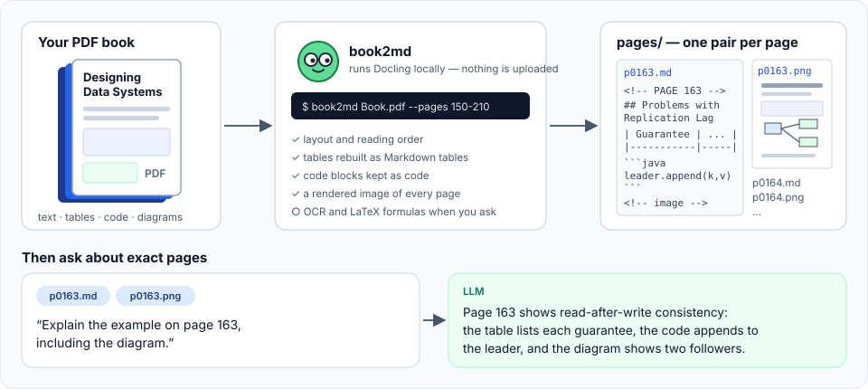

<p align="center">
  
</p>

<h1 align="center">book2md</h1>

<p align="center">
  <strong>Turn a PDF book into one Markdown file and one image per page — so you can hand an LLM the exact pages you are asking about.</strong>
</p>

<p align="center">
  <a href="https://github.com/deadboyccc/pdf-book-to-llm/actions/workflows/ci.yml"></a>
  <a href="https://github.com/deadboyccc/pdf-book-to-llm/releases/latest"></a>
  <a href="LICENSE"></a>
</p>

<p align="center">
  
</p>

Pasting a whole book into a chat loses the structure and blows the context
window. **book2md** splits the book into pages: text, headings, tables and code
become Markdown an LLM reads well, and every page is also saved as an image for
the diagrams. Ask about page 163 and give the model exactly page 163.

Built on [Docling](https://github.com/docling-project/docling) and
[uv](https://docs.astral.sh/uv/). Runs on your machine; nothing is uploaded.

## Features

- **One pair per page** — `p0163.md` + `p0163.png`, named by PDF page number so they sort and match.
- **Structure kept** — headings, paragraphs, Markdown tables and fenced code blocks; figures become `<!-- image -->` placeholders, with the page image as the visual source.
- **Any slice of a book** — `--pages 150-210` writes to its own folder, so a test run never overwrites a full conversion.
- **Scanned books and math** — `--ocr` and `--formulas` (LaTeX) when you need them.
- **Honest results** — failures print one clear line; if Docling skips pages, they are listed and the exit code says so.
- **Tested on the real models** — every commit converts a sample book with the real Docling models in CI.

## Install

You need [uv](https://docs.astral.sh/uv/getting-started/installation/). Works on macOS, Linux and Windows.

```bash
uv tool install git+https://github.com/deadboyccc/pdf-book-to-llm
book2md --version
```

Or work from a clone (`uv sync`, then `uv run book2md …`), or install a wheel from the
[releases](https://github.com/deadboyccc/pdf-book-to-llm/releases). The first conversion
downloads Docling's model weights once (about 1 GB); a GPU (Apple MPS, CUDA) is used when present.
Details: [docs/setup-and-script.md](docs/setup-and-script.md).

## Quick start

```bash
# try a few pages first
book2md books/Book.pdf --pages 1-20

# one chapter
book2md books/Book.pdf --pages 150-210

# the whole book (caffeinate keeps a Mac awake; omit elsewhere)
caffeinate -i book2md books/Book.pdf
```

```console
$ book2md books/Book.pdf --pages 150-210
Converting: Book.pdf  pages=150-210  ocr=False  formulas=False
Converted in 94s. Writing pages...
Done: 61 pages -> /home/you/study/corpus/Book_p150-210/pages
```

Page numbers are **PDF page numbers** — counted from the first page of the file —
not the numbers printed on the pages. If chapter 1 starts on PDF page 25, use 25.

### Options

| Option | Default | Meaning |
|--------|---------|---------|
| `pdf` | required | Path to the PDF (`~` is expanded) |
| `--pages S-E` | all | Pages S to E, 1-based, inclusive. `--pages 120` is one page. Output goes to `<book>_pS-E/` |
| `--out DIR` | `~/study/corpus` | Output root |
| `--ocr` | off | Run OCR. Only for scanned books; much slower. Digital PDFs already contain text |
| `--formulas` | off | Recognise math and emit LaTeX. Slow; for math-heavy books |
| `--scale X` | `1.5` | Page image scale, greater than 0. `2.0` is sharper and larger |
| `--version` | | Print the version |

**Exit codes:** `0` every requested page was written · `1` the conversion failed,
or some pages could not be converted (the others are written and the missing ones
listed) · `2` invalid arguments.

## Output

Written to `<out>/<book>[_pS-E]/pages/`. Nothing is written if the conversion fails.

```
~/study/corpus/Book/pages/
├── p0001.md   p0001.png
├── p0002.md   p0002.png
└── p0163.md   p0163.png
```

Each `.md` starts with a page marker, then that page's content. Both examples below are
real, unedited output from the test book CI converts on every commit (note the tabs Docling
put in the code block):

````markdown
<!-- PAGE 2 -->
## Consistency Guarantees

| Guarantee         | Prevents                 |
|-------------------|--------------------------|
| Read-after-write  | Reading stale own writes |
| Monotonic reads   | Seeing time go backwards |
| Consistent prefix | Answers before questions |
````

````markdown
<!-- PAGE 3 -->
## Appending to the Log

```
public void write(String key, String value) {
		long offset = leader.append(key, value);
		followers.forEach(f -> f.replicate(offset));
	}

```

Figure 1. A leader replicating to two followers.

<!-- image -->
````

## Using the output with an LLM

- **A few pages** — attach `p0163.md` and `p0163.png` together.
- **A chapter** — join a page range into one file; the page markers are kept:
  ```bash
  cd ~/study/corpus/Book/pages
  for n in $(seq 150 209); do cat "p$(printf %04d $n).md"; done > ../pages-150-209.md
  ```
- **Find pages by term** — `grep -l "replication lag" *.md`
- **Diagrams** — attach the page PNG; the Markdown only has a placeholder.
- **Ask with page references** — "Explain the example on page 163."

## Troubleshooting

| Problem | Fix |
|---------|-----|
| Memory pressure on a large book | Convert in ~100-page chunks with `--pages` |
| Garbled or empty text | The PDF is probably scanned; retry with `--ocr` |
| `error: Document has N pages, fewer than the requested page_range start …` | `--pages` starts after the last page; check the PDF page count |
| Exit code 1 and "page(s) could not be converted" | Docling failed on those pages; the rest were written. Retry just those pages with `--pages` |

Environment tasks (rebuilding the venv, updating Docling) are in
[docs/setup-and-script.md](docs/setup-and-script.md#housekeeping).

## How it is tested

| Suite | What it checks | Where it runs |
|-------|----------------|---------------|
| Unit (`tests/unit`) | Arguments, output layout, page writing, error and partial-conversion handling, the Docling options passed — with Docling replaced by fakes | Linux, macOS, Windows · Python 3.10, 3.12, 3.13 |
| End-to-end (`tests/e2e`) | The installed `book2md` command and the **real Docling models** on a generated three-page book: headings, a table, a code block, a figure placeholder, page images, page ranges, clean failures | Linux, every push; converted pages uploaded as a CI artifact |

```bash
uv sync --only-group dev && uv run pytest tests/unit   # seconds, no Docling needed
uv sync && uv run pytest tests/e2e                      # downloads Docling's models on first run
```

## Caveats

- The end-to-end tests prove the pipeline on a clean, digital sample book. Real books
  vary: spot-check code blocks and tables for each new book. Page headers and footers
  occasionally leak into the text.
- Code blocks keep their text but not always their exact indentation — Docling may
  return tabs — and carry no language tag.
- Conversion time depends on book size, hardware and whether OCR is on. Time your
  first book as a baseline.

## Documentation

| Document | For |
|----------|-----|
| [docs/setup-and-script.md](docs/setup-and-script.md) | Installing, the uv environment, and a walkthrough of the script |
| [docs/ASSUMPTIONS.md](docs/ASSUMPTIONS.md) | Decisions taken where the docs were silent |
| [CONTRIBUTING.md](CONTRIBUTING.md) | Developing, testing and releasing |
| [Releases](https://github.com/deadboyccc/pdf-book-to-llm/releases) | What changed in each version |

## License

[AGPL-3.0](LICENSE). Folio the bookworm is part of the project and shares its license.
